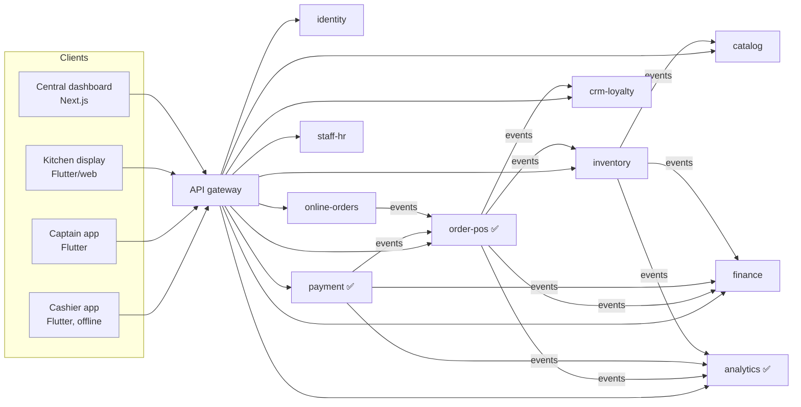
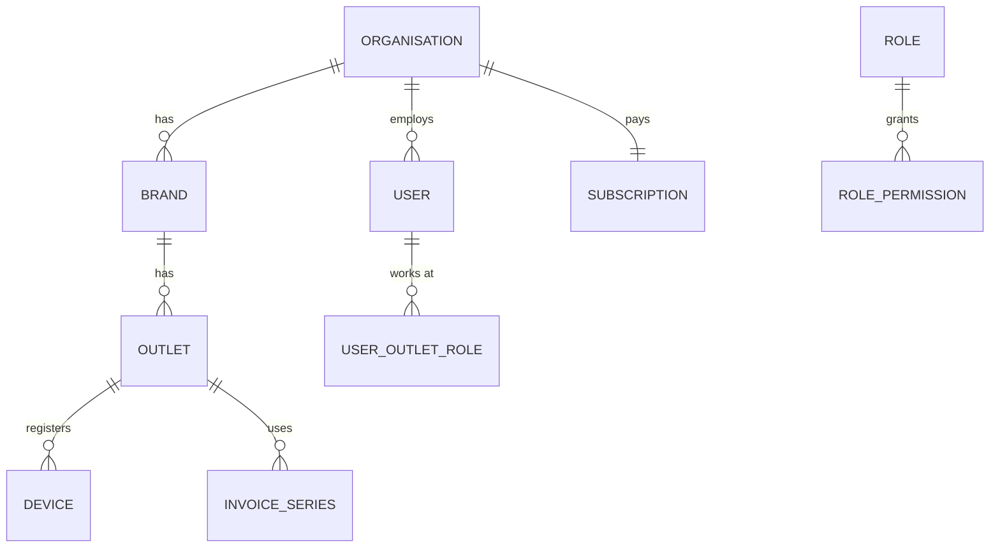
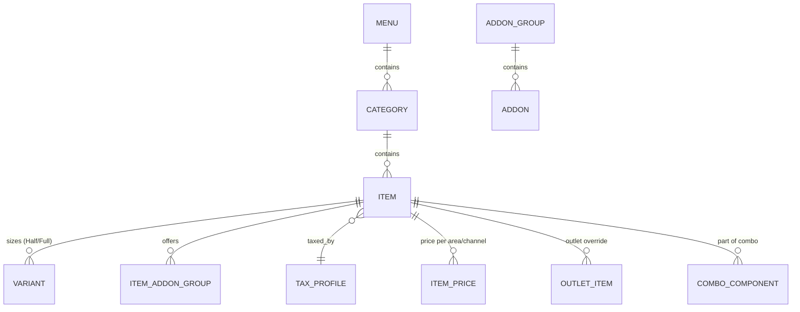
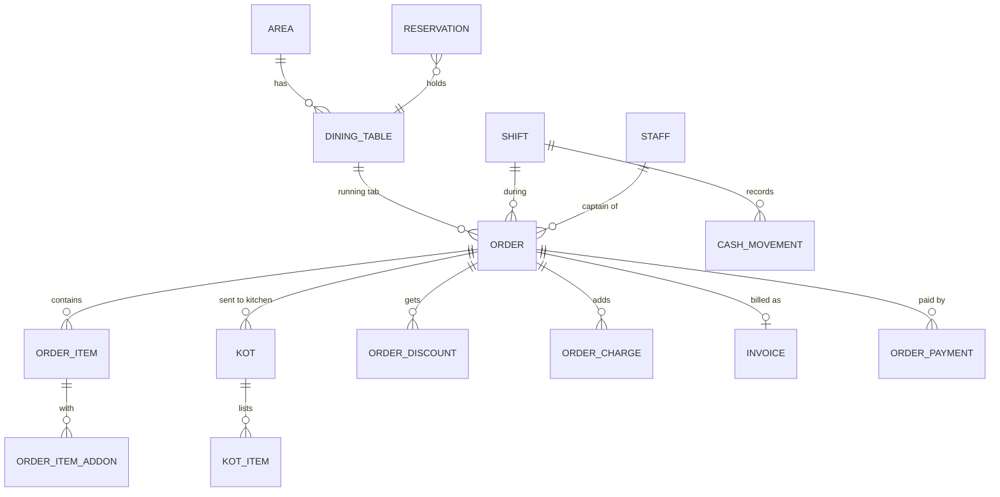
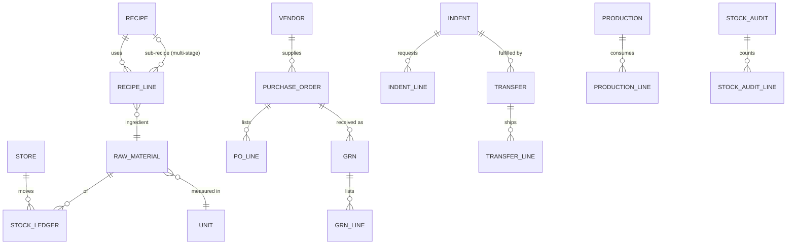
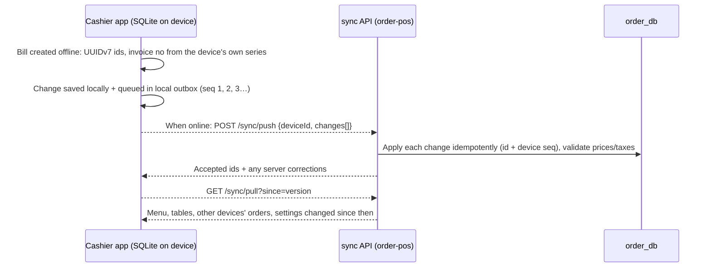

# Restaurant OS: database design

Covers every module of a Petpooja-class product plus our differentiators (finance, CRM, analytics).
Tables marked ✅ already exist; everything else is designed here and gets built module by module.

## 1. Rules that apply to every table

| Rule | Why |
|---|---|
| **One PostgreSQL database per service**, no cross-database joins or foreign keys. Services share data only through events. | Services deploy, scale and fail independently. |
| Every business table has `tenant_id uuid NOT NULL` + **row-level security** (`FORCE`), and app roles have no `BYPASSRLS`. | One restaurant can never see another's data, even if the code has a bug. |
| **Primary keys are UUIDv7, generated by the client** (cashier app, captain app, dashboard). | Offline devices create orders without asking the server; ids sort by time; retries are idempotent. |
| **Money is `bigint` paise**; quantities are `numeric(14,3)` in the item's base unit (g, ml, piece). | No rounding errors; inventory needs fractions (0.250 kg). |
| **Ledgers are append-only** (stock, loyalty points, journals, cash drawer, audit). Corrections are new reversing rows. Triggers block `UPDATE`/`DELETE`. | Auditable history; totals can always be rebuilt. |
| Mutable rows have `created_at`, `updated_at`, `created_by`, `version int` (optimistic locking) and **soft delete** (`deleted_at`). | Safe concurrent edits from many devices; nothing referenced by old bills disappears. |
| Every service has `outbox`, `inbox`, `dead_letters` tables ✅. | Exactly-once effects between services. |
| Timestamps are `timestamptz` (UTC); business dates are `date` in the outlet's time zone (IST). | Reports by "restaurant day", not UTC day. |
| Configuration that varies per outlet is copied as **outlet overrides**, not branched code. | One menu for 50 outlets, with local prices or availability where needed. |

## 2. Services and what they own

| Service | Database | Owns |
|---|---|---|
| identity | `identity_db` | organisations, brands, outlets, users, roles, permissions, devices, subscriptions |
| catalog | `catalog_db` | menus, categories, items, variants, add-ons, taxes, charges, prices per area/channel, availability |
| order-pos ✅ | `order_db` | areas, tables, reservations, orders, KOTs, bills/invoices, discounts, shifts, cash drawer, staff ✅, activity ✅ |
| payment ✅ | `payment_db` | payments, refunds, gateway webhooks, settlements |
| inventory | `inventory_db` | units, raw materials, stores, recipes, stock ledger, vendors, purchase orders, GRN, indents, transfers, production, wastage, audits |
| crm-loyalty | `crm_db` | customers, addresses, loyalty programmes, points ledger, coupons, campaigns, feedback, credit (khata) accounts |
| online-orders | `online_db` | channels (Swiggy, Zomato, ONDC, own site), store mapping, item mapping, raw channel orders, payout statements |
| finance | `finance_db` | chart of accounts, journals, vendor bills, expenses, bank accounts, reconciliation, GST registers |
| staff-hr | `hr_db` | employees, attendance, shifts roster, payroll, tasks/checklists |
| analytics ✅ | `analytics_db` | read-only fact tables built from events (later ClickHouse) |

In Phase 1, `catalog` lives inside `order-pos` (as `menu_items` ✅ does today) and moves out when it grows. The table designs below are the same either way.

---

## 3. Identity & tenancy (`identity_db`)

| Table | Key columns |
|---|---|
| `organisations` | id, name, legal_name, pan, plan, status, created_at |
| `brands` | id, org_id, name, logo_url (one org can run several brands, e.g. cloud kitchens) |
| `outlets` | id, brand_id, name, type (`RESTAURANT`/`CLOUD_KITCHEN`/`CENTRAL_KITCHEN`/`WAREHOUSE`), gstin, fssai_no, address, state_code, timezone, business_day_cutoff (e.g. 04:00), currency, settings jsonb |
| `users` | id, org_id, name, phone, email, auth_subject (Keycloak id), pin_hash (4–6 digit PIN for POS), status |
| `roles` | id, org_id, name, is_system (`OWNER`,`MANAGER`,`CASHIER`,`CAPTAIN`,`KITCHEN`,`STORE_MANAGER`,`ACCOUNTANT`) |
| `permissions` | code (e.g. `bill.discount.apply`, `bill.void`, `inventory.audit.approve`), description |
| `role_permissions` | role_id, permission_code, limit jsonb (e.g. max discount 10%) |
| `user_outlet_roles` | user_id, outlet_id, role_id (same person can be captain at one outlet, manager at another) |
| `devices` | id, outlet_id, name ("Counter 1"), kind (`POS`,`CAPTAIN`,`KDS`,`PRINTER_HUB`), platform, app_version, last_seen_at, is_active, public_key |
| `invoice_series` | id, outlet_id, device_id NULL, prefix ("C1-"), fy ("2627"), next_no — **one series per offline device** so invoices stay gapless without the server (GST allows multiple series) |
| `subscriptions`, `subscription_invoices` | our own SaaS billing per outlet |

## 4. Catalog / menu (`catalog_db`)

| Table | Key columns |
|---|---|
| `menus` | id, brand_id, name, is_default |
| `categories` | id, menu_id, parent_id (sub-categories), name, sort_order, image_url, is_active |
| `items` | id, category_id, name, short_code (for fast billing), description, food_type (`VEG`/`NON_VEG`/`EGG`), item_type (`FOOD`,`BEVERAGE`,`LIQUOR`,`RETAIL`), tax_profile_id, base_price_paise, hsn_sac, kitchen_station_id, prep_minutes, is_combo, is_open_price, allergens text[], image_url, sort_order, is_active |
| `variants` | id, item_id, name ("Half", "Full", "500 ml"), price_paise, recipe_id, is_default |
| `addon_groups` | id, name ("Extra toppings"), min_select, max_select, is_required |
| `addons` | id, group_id, name, price_paise, food_type, recipe_id |
| `item_addon_groups` | item_id, addon_group_id, sort_order |
| `combo_components` | combo_item_id, component_item_id, variant_id, quantity, choice_group |
| `tax_profiles` | id, name ("GST 5%"), components jsonb ([{name:CGST, rate_bp:250},{name:SGST,rate_bp:250}]), is_inclusive |
| `charges` | id, outlet_id, name ("Service charge", "Packing"), kind (`PERCENT`/`FLAT`), value, applies_to (`DINE_IN`,`TAKEAWAY`,`DELIVERY`), taxable |
| `price_areas` | id, outlet_id, name ("AC hall", "Rooftop", "Swiggy") |
| `item_prices` | item_id, variant_id NULL, price_area_id, price_paise |
| `outlet_items` | outlet_id, item_id, is_available, sold_out_until, price_override_paise (local availability / "86") |
| `item_schedules` | item_id or category_id, days_of_week, from_time, to_time (breakfast menu, happy hour) |
| `kitchen_stations` | id, outlet_id, name ("Tandoor", "Bar"), printer_id |
| `printers` | id, outlet_id, name, connection (`LAN`,`BT`,`USB`), address, paper_mm, roles text[] (`BILL`,`KOT`) |
| `menu_publications` | id, menu_id, version, published_at, published_by — devices download a versioned menu snapshot |

## 5. Floor, orders, billing, shifts (`order_db`)

| Table | Key columns |
|---|---|
| `areas` | id, outlet_id, name ("Ground floor", "Terrace"), price_area_id, sort_order |
| `dining_tables` ✅ | id, outlet_id, area_id, label, seats, shape, pos_x, pos_y (floor-plan layout), is_active |
| `reservations` | id, outlet_id, customer_id, guests, reserved_for, table_id, status (`BOOKED`,`SEATED`,`NO_SHOW`,`CANCELLED`), source, notes |
| `waitlist` | id, outlet_id, customer_phone, guests, requested_at, notified_at, seated_at |
| `orders` ✅ | id (client UUID), outlet_id, device_id, shift_id, business_date, order_type (`DINE_IN`,`TAKEAWAY`,`DELIVERY`,`ONLINE`), source (`POS`,`CAPTAIN`,`QR`,`SWIGGY`,`ZOMATO`,`ONDC`,`WEBSITE`), table_id, guests, captain_id ✅, customer_id, status (`OPEN`,`BILLED`,`SETTLED`,`CANCELLED`), bill_requested_at ✅, subtotal/discount/charges/tax/round_off/total paise ✅, notes, client_created_at, sync_version |
| `order_items` | id, order_id, kot_id, item_id, variant_id, name_snapshot, unit_price_paise, quantity, notes ("less spicy"), status (`ACTIVE`,`VOIDED`,`COMPLIMENTARY`), void_reason, voided_by, tax_profile_snapshot jsonb, line_subtotal, line_discount, line_tax, cost_paise |
| `order_item_addons` | order_item_id, addon_id, name_snapshot, price_paise, quantity |
| `kots` ✅ | id (client UUID), order_id, kot_no, station_id, status (`NEW`,`PREPARING`,`READY`,`SERVED`,`CANCELLED`), printed_at, created_by |
| `kot_items` | kot_id, order_item_id, quantity, status (per-item ready state on the KDS) |
| `order_discounts` | id, order_id, order_item_id NULL, kind (`PERCENT`,`FLAT`,`COUPON`,`LOYALTY`), value, amount_paise, reason, coupon_code, approved_by |
| `order_charges` | order_id, charge_id, name_snapshot, amount_paise, tax_paise |
| `order_status_history` | order_id, from_status, to_status, actor, at (append-only) |
| `order_links` | from_order_id, to_order_id, kind (`SPLIT`,`MERGE`,`MOVE_TABLE`) |
| `invoices` | id, order_id, outlet_id, series_id, invoice_no ("C1-2627/000123"), issued_at, totals snapshot, buyer_gstin, irn + signed QR (e-invoice for B2B), cancelled_at, cancel_reason — **gapless per series** |
| `invoice_counters` ✅ | per outlet/FY (online); offline devices use `invoice_series` |
| `order_payments` ✅ | payment_id, order_id, method (`CASH`,`UPI`,`CARD`,`WALLET`,`DUE`,`COMPLIMENTARY`,`ONLINE_PREPAID`), amounts, status, state_version ✅ |
| `shifts` | id, outlet_id, device_id, opened_by, opened_at, opening_cash_paise, closed_by, closed_at, expected_cash_paise, counted_cash_paise, difference_paise, denominations jsonb, status |
| `cash_movements` | id, shift_id, kind (`PAY_IN`,`PAY_OUT`,`SALE`,`REFUND`), amount_paise, reason, actor, at (append-only) |
| `day_closes` | outlet_id, business_date, closed_by, closed_at, totals jsonb (Z-report) |
| `staff` ✅, `activity` ✅ | as built |
| `void_reasons`, `discount_reasons` | id, outlet_id, text — fixed lists so reports can group them |

## 6. Payments (`payment_db`) ✅ built

`payments`, `refunds`, `payment_audit` (append-only), `webhook_events`. To add: `settlements` (gateway payout batches: id, gateway, settled_on, gross, fees, tax, net, utr) and `settlement_lines` (payment_id, amount, fee), used by finance for reconciliation.

## 7. Inventory, purchase & central kitchen (`inventory_db`)

| Table | Key columns |
|---|---|
| `units` | code (`g`,`kg`,`ml`,`l`,`pc`,`dozen`), base_unit, factor (1 kg = 1000 g) |
| `raw_material_categories` | id, name ("Dairy", "Vegetables", "Packaging") |
| `raw_materials` | id, tenant, category_id, name, base_unit, purchase_unit, purchase_factor, kind (`RAW`,`SEMI_FINISHED`,`PACKAGING`,`BEVERAGE`), shelf_life_days, is_perishable, hsn, gst_rate_bp, is_active |
| `stores` | id, outlet_id, name ("Main store", "Bar store", "Kitchen"), kind (`OUTLET`,`CENTRAL_KITCHEN`,`WAREHOUSE`) |
| `store_materials` | store_id, raw_material_id, min_level, reorder_level, max_level, par_level, preferred_vendor_id |
| `recipes` | id, name, yields_quantity, yields_unit, kind (`MENU_ITEM`,`SEMI_FINISHED`), version, is_active |
| `recipe_lines` | recipe_id, raw_material_id **or** sub_recipe_id, quantity, unit, wastage_pct (multi-stage: a curry base is a recipe used inside other recipes) |
| `item_recipes` | item_id, variant_id, addon_id, recipe_id, quantity_factor (maps catalog → recipe) |
| `stock_ledger` | id (bigserial), store_id, raw_material_id, batch_id, moved_at, business_date, quantity (± base unit), unit_cost_paise, value_paise, reason (`PURCHASE`,`SALE_CONSUMPTION`,`TRANSFER_OUT`,`TRANSFER_IN`,`PRODUCTION_IN`,`PRODUCTION_OUT`,`WASTAGE`,`AUDIT_ADJUSTMENT`,`RETURN_TO_VENDOR`,`OPENING`), ref_type, ref_id, actor — **append-only**, the source of truth |
| `stock_balances` | store_id, raw_material_id, quantity, value_paise, avg_cost_paise, updated_at (derived from the ledger, maintained in the same transaction) |
| `batches` | id, raw_material_id, store_id, batch_no, expiry_date, received_at (FIFO/expiry for perishables) |
| `vendors` | id, name, gstin, pan, phone, email, address, payment_terms_days, is_active |
| `vendor_materials` | vendor_id, raw_material_id, vendor_sku, price_paise, unit, lead_time_days |
| `purchase_orders` | id, store_id, vendor_id (or source_store_id for central kitchen), po_no, status (`DRAFT`,`SENT`,`PARTIAL`,`RECEIVED`,`CANCELLED`), expected_on, totals, created_by, approved_by |
| `po_lines` | po_id, raw_material_id, quantity, unit, price_paise, gst_rate_bp, received_quantity |
| `grns` | id, po_id NULL, store_id, vendor_id, invoice_no, invoice_date, received_at, received_by, totals, eway_bill_no |
| `grn_lines` | grn_id, raw_material_id, batch_no, expiry, quantity_received, quantity_rejected, reject_reason, price_paise, gst_paise |
| `vendor_returns` + lines | damaged/expired stock sent back to the vendor |
| `indents` | id, from_store_id (outlet), to_store_id (central kitchen), indent_no, status (`REQUESTED`,`APPROVED`,`PARTIALLY_DISPATCHED`,`DISPATCHED`,`RECEIVED`,`CLOSED`), needed_by, created_by |
| `indent_lines` | indent_id, raw_material_id, quantity_requested, quantity_approved, quantity_dispatched, quantity_received |
| `transfers` | id, indent_id NULL, from_store_id, to_store_id, transfer_no, status (`DISPATCHED`,`IN_TRANSIT`,`RECEIVED`,`DISPUTED`), dispatched_at, received_at, vehicle_no, eway_bill_no, transfer_price_basis |
| `transfer_lines` | transfer_id, raw_material_id, batch_id, quantity_sent, quantity_received, quantity_damaged, unit_cost_paise |
| `delivery_routes` | id, central_store_id, name, stops (outlet ids in order), vehicle, driver |
| `productions` | id, store_id (central kitchen), recipe_id, planned_quantity, produced_quantity, produced_at, produced_by (turns raw materials into semi-finished stock) |
| `production_lines` | production_id, raw_material_id, quantity_consumed |
| `wastages` | id, store_id, raw_material_id or item_id, quantity, reason (`EXPIRED`,`SPOILED`,`OVERCOOKED`,`RETURNED_DISH`,`STAFF_MEAL`), photo_url, recorded_by, approved_by |
| `stock_audits` | id, store_id, kind (`DAILY`,`WEEKLY`,`MONTHLY`,`SPOT`), status (`COUNTING`,`SUBMITTED`,`APPROVED`), counted_at, approved_by |
| `stock_audit_lines` | audit_id, raw_material_id, system_quantity, counted_quantity, variance_quantity, variance_value_paise, reason |
| `consumption_daily` | store_id, raw_material_id, business_date, theoretical_qty (from sales × recipes), actual_qty (from audits), variance — **our differentiator: real food cost and theft/over-portioning detection** |

How a sale reaches inventory: `pos.order.settled` (with item and variant ids) → the inventory service expands each line through `item_recipes` → `recipe_lines` (recursively for semi-finished) → one `SALE_CONSUMPTION` ledger row per raw material. If stock drops below `reorder_level`, it emits `inventory.low_stock`. If an item can no longer be made, it emits `catalog.item.sold_out`, and the cashier and captain apps grey it out.

## 8. Customers, loyalty & marketing (`crm_db`)

| Table | Key columns |
|---|---|
| `customers` | id, tenant, phone (unique per tenant), name, email, birthday, anniversary, gender, tags text[], marketing_consent, consent_at, consent_source, first_visit_at, last_visit_at, visits, lifetime_spend_paise, is_blocked |
| `customer_addresses` | customer_id, label, line1, area, city, pincode, lat, lng |
| `loyalty_programmes` | id, brand_id, name, earn_rule jsonb (₹100 = 5 points), burn_rule jsonb (1 point = ₹0.25), expiry_days, tiers jsonb |
| `loyalty_ledger` | id, customer_id, order_id, kind (`EARN`,`BURN`,`EXPIRE`,`ADJUST`), points, balance_after, at (append-only) |
| `wallets` + `wallet_ledger` | prepaid balance / gift cards |
| `coupons` | id, code, kind, value, min_order_paise, max_discount_paise, valid_from/to, usage_limit, per_customer_limit, applies_to jsonb |
| `coupon_redemptions` | coupon_id, customer_id, order_id, amount_paise |
| `segments` | id, name, rule jsonb (RFM, last visit, favourite items) |
| `campaigns` | id, segment_id, channel (`WHATSAPP`,`SMS`,`EMAIL`), template_id, scheduled_at, status, sent/delivered/clicked/converted counts |
| `campaign_messages` | campaign_id, customer_id, provider_message_id, status, sent_at |
| `feedback` | id, order_id, customer_id, rating (1–5), food/service/ambience ratings, comment, channel, handled_by, handled_at |
| `credit_accounts` + `credit_ledger` | khata for regulars and corporate clients: limit, balance, monthly statements |

## 9. Online orders & aggregators (`online_db`)

| Table | Key columns |
|---|---|
| `channels` | code (`SWIGGY`,`ZOMATO`,`ONDC`,`WEBSITE`,`QR`), name, integration_mode (direct / via integrator) |
| `channel_stores` | id, outlet_id, channel_code, external_store_id, is_online, auto_accept, prep_minutes, credentials_ref (secret manager key, never the secret itself) |
| `channel_item_mappings` | channel_store_id, item_id, variant_id, external_item_id, price_paise, is_available |
| `channel_orders` | id, channel_store_id, external_order_id (unique per channel), raw_payload jsonb, status (`PLACED`,`ACCEPTED`,`REJECTED`,`READY`,`PICKED_UP`,`DELIVERED`,`CANCELLED`), order_id (our POS order), rider info, timestamps per status |
| `channel_payouts` | id, channel_store_id, period_from/to, gross, commission, gst_on_commission, tcs, tds, ads, penalties, refunds, net, utr, file_ref |
| `channel_payout_lines` | payout_id, external_order_id, order_id, amounts…, match_status (`MATCHED`,`MISSING_ORDER`,`AMOUNT_MISMATCH`), dispute_status |

## 10. Finance & accounting (`finance_db`)

| Table | Key columns |
|---|---|
| `accounts` | id, tenant, code, name, type (`ASSET`,`LIABILITY`,`EQUITY`,`INCOME`,`EXPENSE`), parent_id, is_system (restaurant template: sales by channel, output CGST/SGST/IGST, input GST, COGS, commission, gateway fees, rent, salaries, cash, bank, UPI clearing…) |
| `journals` | id, outlet_id, business_date, source_type (`INVOICE`,`PAYMENT`,`REFUND`,`GRN`,`VENDOR_BILL`,`EXPENSE`,`PAYOUT`,`MANUAL`), source_id, narration, posted_at, reversed_by — append-only |
| `journal_lines` | journal_id, account_id, debit_paise, credit_paise, cost_centre (outlet), CHECK one side only; each journal balances (deferred constraint) |
| `posting_rules` | event_type, template jsonb (which accounts to debit/credit), tenant override |
| `vendor_bills` + lines | from GRNs, due_date, paid_paise, status |
| `vendor_payments` | bill allocations, mode, utr |
| `expenses` | category, amount, period (`ONE_TIME`/`MONTHLY`, accrued by day), receipt_url (OCR), approved_by (already in analytics as a first version ✅) |
| `bank_accounts`, `bank_statement_lines` | imported statements; matched_journal_id |
| `gst_returns` | period, gstr1 jsonb, gstr3b jsonb, status, filed_at |
| `period_locks` | outlet_id, locked_until (no edits to closed months) |

## 11. Staff, attendance, payroll, tasks (`hr_db`)

`employees` (links to `users`, salary structure, joining date, documents), `attendance` (clock in/out with photo and geofence, device_id), `rosters` (planned shifts), `leaves`, `payroll_runs` + `payslips` (earnings, deductions, PF/ESI, tips share), `tip_pools`, `task_templates` (opening/closing/hygiene checklists), `task_runs` + `task_run_items` (done_by, photo_url, done_at), `licences` (FSSAI, fire, trade, excise: expiry reminders).

## 12. Platform tables (every service)

`outbox` ✅, `inbox` ✅, `dead_letters` ✅, `audit_log` (who changed what: entity, entity_id, action, before/after jsonb, actor, device, ip, at; append-only), `idempotency_keys`, `sync_cursors` (device_id, entity, last_server_version), `file_uploads` (R2 object keys for photos, receipts, invoices).

## 13. Offline sync for the Flutter cashier app

- **The device database mirrors a slice of the server**: today's menu snapshot, tables, open orders, the device's invoice series, customers seen recently, and its own outbox of pending changes.
- **Conflicts:** orders and payments are append-only events (KOT added, payment added), so two devices merge naturally. Table status is recomputed on the server. Menu and settings are server-wins.
- **Invoice numbers offline:** each device has its own series (`C1-`, `C2-`), so numbers stay gapless and unique without the server.
- **Money is checked again on the server** when changes sync. A device can't invent prices or discounts beyond its permissions; anything rejected comes back flagged for the manager.

## 14. Additions from the Petpooja research

| Area | Tables / columns |
|---|---|
| Order-type rules | `items.order_types`, `tax_profiles.order_types`, `discount_rules.order_types` (dine-in / takeaway / delivery availability, as in Petpooja's API) |
| Item extras | `items.markup_price_paise` (strike price), `spice_level`, `tags text[]` (chef special, new), `ignore_discounts`, `ignore_taxes`, `packing_charge_paise`, `is_recommended` |
| Discount rules | `discount_rules`: kind (`PERCENT`,`FLAT`,`BOGO`,`BXGY`,`FREEBIE`), applies_to (`ALL`,`CATEGORIES`,`ITEMS`), on_total, min_bill_paise, max_discount_paise, days_of_week, from/to time, valid_from/to, needs_coupon, max_per_user_role |
| Charges | `charges.level` (`ITEM`,`ORDER`) for packing, `basis` (`CORE`,`TOTAL`), `taxable` |
| KOT types | `kots.kind` (`NEW`,`MODIFY`,`CANCEL`,`TRANSFER`), `kots.reason`, `kots.reprint_count`; `kot_items.delta_quantity` (− for cancellations) |
| Leakage panel | view over `kots` (cancelled/modified/unbilled), `invoices.reprint_count`, `order_links` (table moves), `order_payments` changed after settlement, built from `audit_log` |
| Permissions | `bill.discount.max_pct`, `bill.void`, `bill.complimentary`, `bill.after_settlement_edit`, `bill.reprint`, `order.move_table`, `report.view.<name>`, `settings.tax`, `users.manage` |
| Advance orders | `orders.deliver_at`, `orders.advance_paise` (bakery/cake pre-orders) |
| Tokens | `orders.token_no` (daily sequence per outlet), `token_displays` (TV devices), `orders.ready_at`, `orders.picked_up_at` |
| QR scan & order | `table_qr_codes` (table_id, token, is_enabled), `qr_sessions` (table, phone, otp_verified_at), orders with `source = 'QR'` |
| Kiosk | devices kind `KIOSK`, orders `source = 'KIOSK'`, pay-before-KOT flag |
| Reservations | `reservations.deposit_paise`, `deposit_payment_id`, `refund_status`, `source` (`ZOMATO_DINING`,`DISTRICT`,`EAZYDINER`,`LINK`,`PHONE`,`WALK_IN`), `reservation_events` (event / private dining enquiries) |
| Waiter call | `call_devices` (table_id, battery, last_seen), `table_calls` (kind `WATER`,`WAITER`,`BILL`, raised_at, accepted_by, done_at), `table_call_mutes` |
| Digital menu boards | `display_screens`, `display_playlists`, `display_items` (image/video, schedule) |
| Prepaid cards | `prepaid_cards` (card_no, balance), `prepaid_ledger` (food courts, canteens) |
| Liquor | raw materials with `kind = 'LIQUOR'`, recipes in ml (peg = 30/60 ml), bottle ↔ ml conversion in `units` |
| Purchase Manager | `vendor_rate_cards` (vendor_id, uploaded_at, file_ref), `vendor_rate_card_lines` (raw_material_id, price, valid_until) to compare vendors and build the cheapest cart |
| Daily stock closing | `stock_audits.kind = 'DAILY'`, `stock_closing_calendar` view (days not yet closed, accuracy score) |
| Call centre | `call_centre_orders` (agent_id, caller_phone, chosen outlet) feeding normal orders with `source = 'CALL_CENTRE'` |
| Reviews & referrals | `reviews` (platform, rating, text, replied_at, reply), `referrals` (referrer, referee, reward status) |
| E-bills | `ebill_deliveries` (invoice_id, channel, phone, status, link_token) |
| Multi-brand outlets | `orders.brand_id`, `items` via `menus.brand_id` (cloud kitchens with several brands in one outlet) |
| Head office | `zones` (region/state/city grouping of outlets), `menu_push_jobs` + `menu_push_targets` (per-outlet progress and log) |

## 15. What is built vs designed

| Area | Status |
|---|---|
| Payments, refunds, webhooks, reconciliation | ✅ built |
| Orders, tables, KOTs, invoices, captains, activity | ✅ built (orders store lines directly; `order_items` with add-ons is the next step) |
| Analytics read model, P&L, CRM segments | ✅ built (first version, from events) |
| Identity, catalog (variants, add-ons, price areas), shifts/cash, inventory, central kitchen, purchase, online channels, finance ledger, HR | 📐 designed here, to be built module by module |
